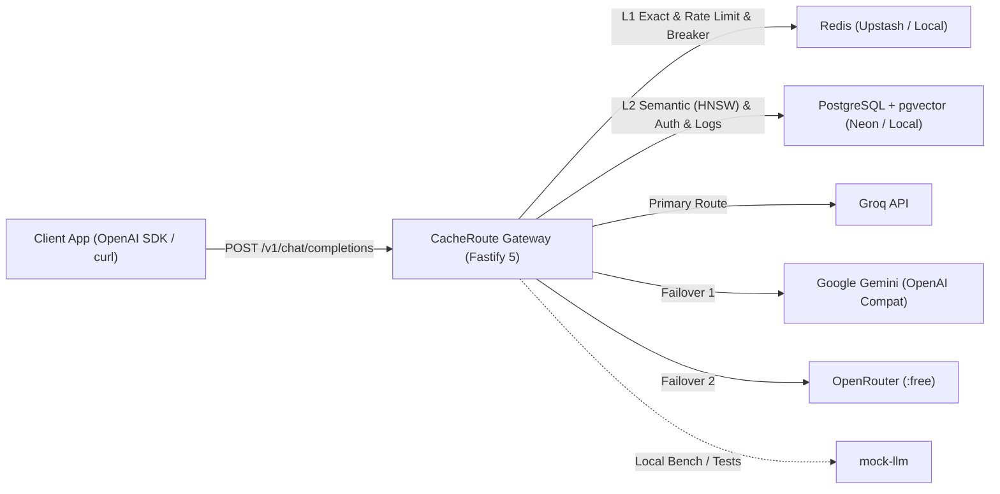

# CacheRoute

> **Status: v1.0 Live in Production — CI Green, Local `B1`–`B5` Benchmarks & Live Vercel + Neon + Upstash Deployment Verified.**
>
> **Live API Base URL:** `https://gateway-one-coral.vercel.app` (Vercel Fluid Compute `iad1` + Neon `pgvector` + Upstash Redis)

An OpenAI-compatible LLM gateway built with TypeScript and Fastify 5 featuring two-tier exact + semantic caching, multi-provider failover, distributed Redis circuit breakers, token-bucket rate limiting, daily token budgets, and observability.

## In Plain Words

CacheRoute sits between your apps and AI model providers (Groq, Google Gemini, OpenRouter). If a question was already asked — or asked in slightly different words — CacheRoute answers from its cache in milliseconds instead of waiting for and paying an upstream model. If one AI provider errors out or hits a rate limit, CacheRoute automatically switches to the backup provider without breaking the client request.

## Features

- **Drop-in OpenAI Compatibility:** Implements `POST /v1/chat/completions` (JSON + SSE streaming) and `GET /v1/models`.
- **Two-Tier Caching:**
  - **L1 Exact Cache (Redis):** SHA-256 hash of canonicalized request fields (`24h` TTL).
  - **L2 Semantic Cache (`pgvector` HNSW):** Local 384-dim ONNX embeddings (`Xenova/all-MiniLM-L6-v2` q8) with calibrated cosine similarity threshold (`0.92` default), tenant/model/context scoping, and an **Entity Guard** to prevent false-positive hits.
- **Multi-Provider Failover & Circuit Breakers:** Routes model aliases (`cr-fast`, `cr-smart`, `mock`) across Groq, Gemini, and OpenRouter with Redis-backed atomic Lua circuit breakers (`CLOSED` → `OPEN` → `HALF_OPEN`).
- **Rate Limits & Token Budgets:** Atomic Redis Lua token bucket (`60` rpm, burst `20` default) + daily token budget (`200,000` tokens/day default) with OpenAI-standard headers.
- **Observability:** Response trace headers (`x-cacheroute-*`), local `/metrics` (Prometheus) + provisioned Grafana dashboard, and production PostgreSQL `request_logs` via `waitUntil` + `GET /admin/stats`.

## Architecture Overview



## Tech Stack

| Layer | Technology |
| :--- | :--- |
| **Runtime & Language** | Node.js 24 LTS, TypeScript (strict, ESM) |
| **HTTP & Validation** | Fastify 5, Zod (`fastify-type-provider-zod`), Node `fetch`/`undici` |
| **L1 Cache, Rate Limit, Breaker** | Redis (`ioredis` + atomic Lua scripts) |
| **L2 Semantic Cache & Logs** | PostgreSQL + `pgvector` (HNSW `vector_cosine_ops`), Drizzle ORM (`pg`) |
| **Local Embeddings** | `@huggingface/transformers` (`Xenova/all-MiniLM-L6-v2`, q8, 384 dims) |
| **Observability** | Pino logs, `prom-client` (`/metrics`), Grafana, Postgres `request_logs` |
| **Testing & Benchmarks** | Vitest, `mock-llm`, Docker `grafana/k6`, `bench/ttft/ttft.ts`, GitHub Actions |
| **Hosting (Production)** | Vercel (Fluid Compute, `iad1`) + Neon (`aws-us-east-1`) + Upstash (`us-east-1`) |

## Documentation Index

| Document | Description |
| :--- | :--- |
| [00 — Research](docs/00-RESEARCH.md) | Market landscape (LiteLLM, Portkey, Helicone, Cloudflare, GPTCache), pgvector vs Redis, free-tier limits |
| [01 — Product Spec](docs/01-PRODUCT-SPEC.md) | Problem statement, goals, non-goals, functional & non-functional requirements |
| [02 — Architecture](docs/02-ARCHITECTURE.md) | System diagrams, sequence flows, ports/adapters OOP design, folder layout, failure modes |
| [03 — Request Pipeline](docs/03-REQUEST-PIPELINE.md) | The 11 ordered pipeline stages, headers, and error mapping |
| [04 — Caching](docs/04-CACHING.md) | Exact + semantic cache keys, entity guard, calibration, SSE replay, safety rules |
| [05 — Resilience](docs/05-RESILIENCE.md) | Timeouts, error matrix, circuit breaker state machine & Lua scripts, degraded mode |
| [06 — Data Model](docs/06-DATA-MODEL.md) | PostgreSQL ER diagram, DDL/indexes, Redis key schema, retention policy |
| [07 — API Reference](docs/07-API.md) | Endpoints, OpenAI error format, curl & OpenAI SDK examples |
| [08 — Tech Stack & ADRs](docs/08-TECH-STACK-AND-DECISIONS.md) | Stack rationale and Architecture Decision Records (ADR-001 through ADR-009) |
| [09 — Testing & Benchmarks](docs/09-TESTING-AND-BENCHMARKS.md) | Test pyramid, `mock-llm` fault injector, B1–B5 benchmark suite, calibration |
| [10 — Deployment](docs/10-DEPLOYMENT.md) | Prerequisites, local Docker Compose, Vercel + Neon + Upstash setup, Phase 0 spike gate |
| [11 — Roadmap & Risks](docs/11-ROADMAP.md) | Phased execution plan (Phases 0–7) and Risk Register (R1–R5) |
| [Glossary](docs/GLOSSARY.md) | Plain-English definitions of gateway, SSE, TTFT, circuit breakers, and backend terms |

## Measured Benchmarks (`B1`–`B5` + Streaming TTFT)

All benchmarks run **locally** against `mock-llm` with Docker Compose (`pgvector/pgvector:pg17` + `redis:7-alpine`).
- **Hardware:** `AMD Ryzen 7 7700 8-Core Processor (16 logical cores) | 15.1 GB RAM | Windows 11 (x64, build 26300) | Node.js v24.7.0 | Docker 29.4.3`

| ID | Benchmark | Target (Local) | Measured Result |
| :--- | :--- | :--- | :--- |
| **B1** | Gateway overhead (`bypass`, 0ms mock) | Added `p95 < 15 ms` | Added **`p50 = 8.60 ms`**, **`p95 = 14.92 ms`** |
| **B2** | Two-tier cache (1,000-req mix, 800ms mock) | Exact `p95 < 10 ms`, Semantic `p95 < 60 ms`, FP `<= 1%` | Exact **`p95 = 7.08 ms`** (`p50 = 3.10 ms`), Semantic **`p95 = 15.25 ms`** (`p50 = 8.17 ms`), **FP `0.00%`** (`59.4%` hit rate) |
| **B3** | Failover resilience (30% 5xx + 5% faults) | `>= 99.9%` client success rate | **`100.00%` (`200/200`)** client success (`p50 = 17.58 ms`, `p95 = 33.52 ms`) |
| **B4** | Rate-limit accuracy (100-request burst) | Exact expected `429` count (`60` rpm / `20` burst) | **`20` `200 OK` / `80` `429 Too Many Requests`** (100% atomic accuracy) |
| **B5** | Cache-hit throughput (40 concurrency) | Max RPS with `p95 < 100 ms` | **`3,526 RPS`** (`p50 = 10.71 ms`, **`p95 = 19.19 ms`**, `p99 = 22.35 ms`) |
| **TTFT** | Streaming SSE cache replay vs 250ms mock | Near-instant synthetic SSE TTFT | Exact **`p95 = 4.34 ms`**, Semantic **`p95 = 9.77 ms`** (vs `389.11 ms` miss) |

### Live Production Smoke Test (`Vercel iad1` + `Neon pgvector` + `Upstash Redis`)

| Live Check | Provider / Tier | Measured Server Latency |
| :--- | :--- | :---: |
| **`POST /v1/chat/completions` (`MISS`)** | Groq (`openai/gpt-oss-20b`, `cr-fast`) | `991 ms` |
| **`POST /v1/chat/completions` (`HIT-EXACT`)** | Upstash Redis L1 (`iad1`) | **`7 ms`** *(141× speedup)* |
| **`POST /v1/chat/completions` (`HIT-SEMANTIC`)** | ONNX (`Xenova/all-MiniLM-L6-v2` q8) + Neon `pgvector` HNSW (`similarity: 0.9657`) | **`26 ms`** *(38× speedup)* |
| **`POST /v1/chat/completions` (`stream: true` hit)** | Synthetic SSE cache replay (`data: [DONE]`) | **`7 ms` TTFT** |

## Quick Start

```bash
# 1. Install workspace dependencies
npm install

# 2. Start PostgreSQL (pgvector:pg17) & Redis 7
docker compose -f infra/docker-compose.yml up -d --wait postgres redis

# 3. Run lint, typecheck, unit tests, and integration tests
npm run lint
npm run typecheck
npm run test:unit
npm run test:integration

# 4. Run threshold calibration & local benchmarks
npm run calibrate
npx tsx bench/run-benchmarks.ts
npm run bench:ttft
```
