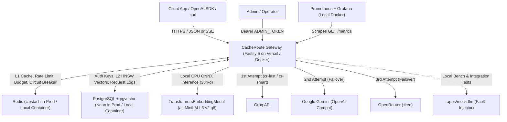
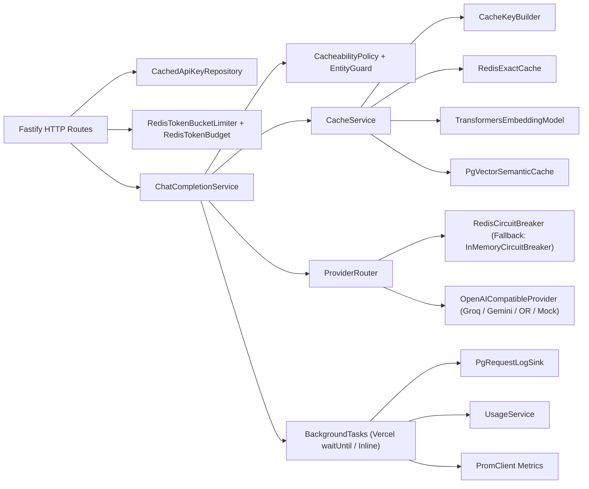
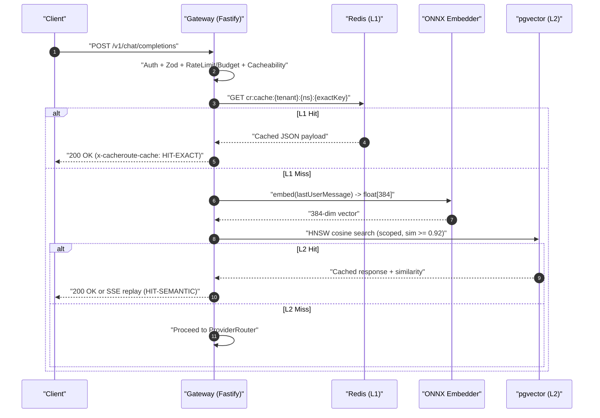
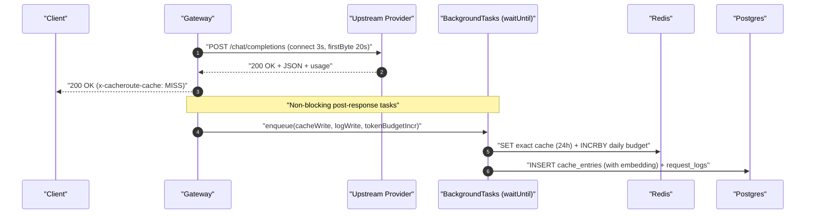
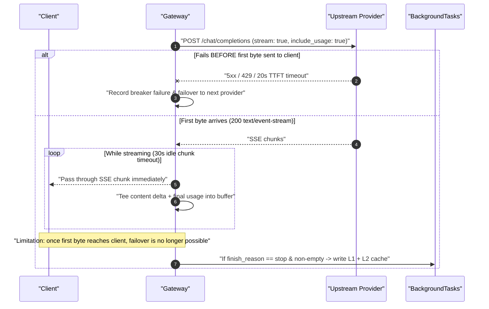
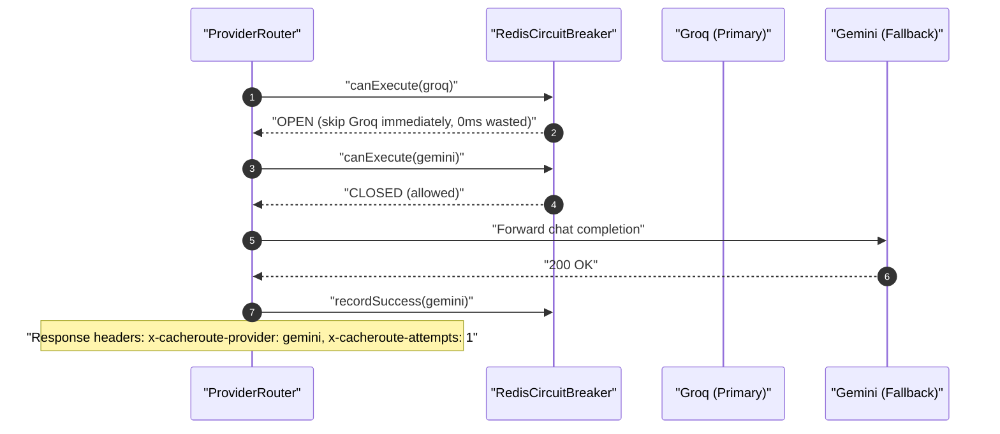

# 02 — System Architecture

## In Plain Words

CacheRoute is built as a modular TypeScript backend using **Ports and Adapters** (also called Hexagonal Architecture). Business logic never talks directly to Redis, Postgres, or Groq — it talks to clean TypeScript interfaces (`ports/`), and concrete classes (`adapters/`) plug into those interfaces inside a single wiring file (`container.ts`). This makes every component easy to test, swap, and reason about.

---

## 1. System Context Diagram



---

## 2. Internal Component Architecture



---

## 3. Sequence Diagrams

### 3.1 Exact Cache Hit (L1) & Semantic Cache Hit (L2)



### 3.2 Non-Stream Miss & Background Persistence



### 3.3 Streaming Miss with SSE Tee & Cache Replay Limitation



### 3.4 Failover with an Open Circuit Breaker



---

## 4. Object-Oriented Ports & Adapters Design

All core abstractions live in `ports/`, concrete implementations live in `adapters/`, orchestration lives in `services/`, pure rules live in `domain/`, and everything is wired once in `container.ts` via constructor injection (no reflection or DI framework).

| Layer | Type / Class | Responsibility |
| :--- | :--- | :--- |
| **ports/** | `LlmProvider` | Interface for upstream completion & streaming calls |
| **ports/** | `EmbeddingModel` | Interface `embed(text: string): Promise<number[]>` (384 dims) |
| **ports/** | `ExactCacheStore` | Interface for L1 key get/set/delete |
| **ports/** | `SemanticCacheStore` | Interface for L2 vector search & insert |
| **ports/** | `RateLimiter` | Interface for token-bucket consume check |
| **ports/** | `TokenBudget` | Interface for daily token check & increment |
| **ports/** | `CircuitBreaker` | Interface for `canExecute`, `recordSuccess`, `recordFailure` |
| **ports/** | `ApiKeyRepository` | Interface for key lookup, creation, revocation, namespace bump |
| **ports/** | `RequestLogSink` | Interface for writing `request_logs` and querying `/admin/stats` |
| **ports/** | `BackgroundTasks` | Interface `run(fn: () => Promise<void>): void` |
| **ports/** | `Clock` | Interface `nowMs(): number` for deterministic unit testing |
| **adapters/** | `OpenAICompatibleProvider` | Configurable HTTP/SSE adapter using `undici` keep-alive pool (Groq, Gemini, OpenRouter, mock) |
| **adapters/** | `TransformersEmbeddingModel` | Singleton ONNX `Xenova/all-MiniLM-L6-v2` (q8) embedder |
| **adapters/** | `RedisExactCache` | `ioredis` L1 JSON store with `24h` TTL |
| **adapters/** | `PgVectorSemanticCache` | Drizzle + `pg` HNSW cosine search & `relaxed_order` iterative scan |
| **adapters/** | `RedisTokenBucketLimiter` | Atomic Lua token bucket (`EVALSHA` + `NOSCRIPT` reload) |
| **adapters/** | `RedisTokenBudget` | Daily token counter (`INCRBY`, `48h` TTL) |
| **adapters/** | `RedisCircuitBreaker` | Distributed breaker state + `SET NX` half-open probe lock in Lua |
| **adapters/** | `InMemoryCircuitBreaker` | Per-instance fallback breaker when Redis is unreachable |
| **adapters/** | `PgApiKeyRepository` | Postgres CRUD for `api_keys` |
| **adapters/** | `CachedApiKeyRepository` | Decorator wrapping `PgApiKeyRepository` with a 60s Redis cache |
| **adapters/** | `PgRequestLogSink` | Inserts `request_logs` and computes aggregated stats |
| **adapters/** | `VercelBackgroundTasks` | Uses `@vercel/functions` `waitUntil` |
| **adapters/** | `InlineBackgroundTasks` | Fire-and-forget with error logging for local Docker/tests |
| **services/** | `ChatCompletionService` | Coordinates pipeline stages 5–11 (cache, route, stream tee, bg tasks) |
| **services/** | `ProviderRouter` | Resolves model alias routes, enforces max 3 attempts, drives breakers |
| **services/** | `CacheService` | Coordinates L1 exact, L2 semantic, threshold check, and writeback |
| **services/** | `UsageService` | Logs requests, updates metrics, and increments daily token budgets |
| **domain/** | `CacheKeyBuilder` | Canonical JSON sorting, SHA-256 `exact_key` & `scope_hash` generation |
| **domain/** | `CacheabilityPolicy` | Evaluates request/response cache eligibility rules |
| **domain/** | `EntityGuard` | Regex detection for 3+ digit numbers, emails, and URLs |
| **domain/** | `GatewayError` | Typed error hierarchy mapped to OpenAI HTTP error responses |

---

## 5. Planned Folder Tree

```text
E:\Github\CacheRoute\
├── apps/
│   ├── gateway/                  # Deployed to Vercel (Root Directory: apps/gateway)
│   │   ├── src/
│   │   │   ├── domain/           # Pure policies, key builders, errors
│   │   │   ├── ports/            # Interfaces
│   │   │   ├── adapters/         # Redis, pgvector, Transformers.js, OpenAI-compat, Vercel waitUntil
│   │   │   ├── services/         # Orchestration services
│   │   │   ├── routes/           # Fastify route plugins (/v1/*, /admin/*, /healthz, /metrics)
│   │   │   ├── db/               # Drizzle schema & migrations
│   │   │   ├── lua/              # token_bucket.lua, circuit_breaker.lua
│   │   │   ├── config.ts         # Zod-validated env + model alias route map
│   │   │   ├── container.ts      # Single manual composition root
│   │   │   └── server.ts         # Fastify entrypoint
│   │   ├── tests/
│   │   │   ├── unit/
│   │   │   └── integration/
│   │   ├── Dockerfile
│   │   ├── package.json
│   │   └── tsconfig.json
│   └── mock-llm/                 # Local/CI fault-injecting OpenAI mock server
│       ├── src/
│       └── package.json
├── bench/
│   ├── k6/                       # B1–B5 non-streaming load scripts
│   ├── ttft/                     # bench/ttft/ttft.ts streaming TTFT script
│   ├── datasets/                 # paraphrase-pairs.jsonl & 1,000-req replay mix
│   └── results/                  # Captured JSON summaries (gitignored raw, summary in docs/README)
├── infra/
│   ├── docker-compose.yml        # pgvector:pg17, redis:7-alpine, mock-llm, gateway, prometheus, grafana
│   ├── prometheus/
│   └── grafana/provisioning/
├── docs/                         # 00-RESEARCH.md through 11-ROADMAP.md + GLOSSARY.md
├── .github/workflows/ci.yml
├── package.json                  # npm workspaces: ["apps/*"]
└── README.md
```

---

## 6. Deployment Topologies

1. **Local Development & Benchmarking (Docker Compose):**
   - Gateway container + `mock-llm` + `pgvector/pgvector:pg17` + `redis:7-alpine` + `prom/prometheus` + `grafana/grafana`.
   - `grafana/k6` runs ephemerally against the Docker network to execute `B1`–`B5`.
2. **Production (Vercel Hobby + Neon + Upstash):**
   - `apps/gateway` runs on Vercel Fluid Compute (Node.js 24 LTS, pinned to `iad1`).
   - Postgres runs on Neon (`aws-us-east-1`) with `pgvector`.
   - Redis runs on Upstash (`us-east-1`) via `ioredis` TLS.
   - Background writes use `waitUntil` so client response latency is unaffected by database/cache writes.

---

## 7. Failure Modes Summary

| Dependency / Component | Failure Mode | Gateway Behavior |
| :--- | :--- | :--- |
| **Redis Down / Timeout** | Network error or `500 ms` timeout | Rate limiting **fails open**; L1 skipped; breaker switches to `InMemoryCircuitBreaker`; error logged & metered |
| **Postgres Down / Timeout** | Query/connection failure | Cached auth keys still pass; uncached auth keys return **`503` (fail-closed)**; L2 skipped; request logs dropped (counted) |
| **Primary LLM 429 / 5xx / Timeout** | Provider error or `20s` TTFT exceeded | Breaker records failure; router fails over to next provider (up to 3 total attempts) |
| **All Providers Failed** | All routes open or failing | Returns `503` in OpenAI error JSON (`code: all_providers_failed`) |
| **Stream Drops After First Byte** | Upstream resets mid-SSE stream | Emits SSE error event + `[DONE]` and closes stream cleanly; cannot failover mid-stream |
