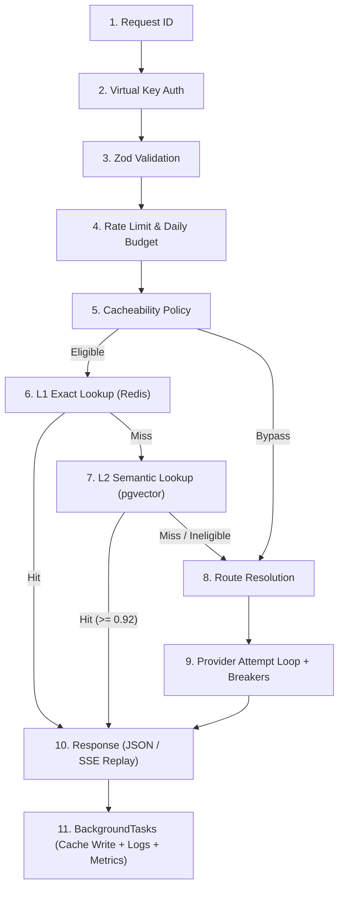

# 03 — Request Pipeline

## In Plain Words

Every `POST /v1/chat/completions` call walks through **11 ordered stages** — from assigning a trace ID and checking the API key, through rate limits and two cache tiers, down to calling AI providers and saving logs in the background after the client already has its answer.

---

## 1. Pipeline Overview



---

## 2. The 11 Ordered Stages

| # | Stage | Input | Output | Failure Behavior | Time Budget |
| :-: | :--- | :--- | :--- | :--- | :--- |
| **1** | **Request ID** | Incoming `x-request-id` header (or absent) | Normalized `requestId` attached to logger & response header | Always succeeds (generates UUIDv4 if missing) | `< 0.1 ms` |
| **2** | **Auth (Virtual Key)** | `Authorization: Bearer cr_live_<32>` | `ApiKeyContext` (`tenantId`, `rpm`, `burst`, `budget`, `namespace`, `semanticEnabled`) | Missing/invalid/revoked → `401`; uncached key + DB down → `503` (fail-closed) | `< 1 ms` (Redis hit) / `< 10 ms` (DB) |
| **3** | **Zod Schema Validation** | Raw JSON request body | Typed OpenAI `ChatCompletionRequest` | Malformed JSON or invalid schema → `400 invalid_request_error` | `< 0.5 ms` |
| **4** | **Rate Limit & Budget** | `tenantId`, `rpm_limit`, `burst`, `daily_token_budget` | Allowed status + remaining quota headers | Token bucket empty → `429` + `Retry-After`; daily budget exhausted → `429`; Redis down → fail-open | `< 2 ms` |
| **5** | **Cacheability Decision** | Request + `x-cacheroute-cache` header + key config | `{ exactEligible, semanticEligible, bypassReason }` | Pure evaluation; never throws | `< 0.2 ms` |
| **6** | **L1 Exact Lookup** | `tenantId`, `namespace`, `exact_key` SHA-256 | Cached response or `null` | Redis down → treat as miss, log & continue | `< 3 ms` |
| **7** | **L2 Semantic Lookup** | Last user message → 384-d ONNX embedding + `scope_hash` | Cached response + similarity (`>= 0.92`) or `null` | Embedder/Postgres error → treat as miss, log & continue | `< 45 ms` |
| **8** | **Route Resolution** | Requested `model` alias (`cr-fast`, `cr-smart`, `mock`) | Ordered provider list (e.g., Groq → Gemini → OpenRouter) | Unknown model alias → `400 model_not_found` | `< 0.1 ms` |
| **9** | **Provider Attempt Loop** | Provider chain (max `3` attempts, no same-provider retry) | Upstream JSON or SSE stream + `attempts` count | Client 4xx → return immediately; 401/403/408/429/5xx/timeout → failover; all failed → `503` | `3s` connect / `20s` TTFT / `120s` total |
| **10** | **Response Serialization** | Hit payload or upstream JSON / SSE stream | HTTP `200` JSON or `text/event-stream` with `x-cacheroute-*` headers | Stream drop post-first-byte → emit SSE error event + `[DONE]` | Streaming: `30s` chunk idle |
| **11** | **Background Tasks** | `waitUntil` (Vercel) or inline async (local) | L1/L2 cache write (if `200` + `finish_reason == "stop"` + non-empty), `request_logs` row, `INCRBY` budget, Prometheus counters | Errors caught and logged/counted; never fail client response | Non-blocking |

---

## 3. Response Headers

Every `/v1/chat/completions` response includes both CacheRoute diagnostic headers and OpenAI-style rate-limit headers:

| Header | Values / Format | When Included |
| :--- | :--- | :--- |
| `x-request-id` | Echoed or generated UUIDv4 | Always |
| `x-cacheroute-cache` | `HIT-EXACT` \| `HIT-SEMANTIC` \| `MISS` \| `BYPASS` | Always on `/v1/chat/completions` |
| `x-cacheroute-provider` | e.g. `groq`, `gemini`, `openrouter`, `mock-primary`, `cache` | Always on `/v1/chat/completions` |
| `x-cacheroute-attempts` | Integer `0` (cache hit) or `1`–`3` | Always on `/v1/chat/completions` |
| `x-cacheroute-latency-ms` | Total gateway processing duration in ms | Always on `/v1/chat/completions` |
| `x-cacheroute-similarity` | Float `0.9200`–`1.0000` (cosine similarity) | Only when `x-cacheroute-cache: HIT-SEMANTIC` |
| `x-ratelimit-limit-requests` | Configured `rpm_limit` (e.g. `60`) | Authenticated requests |
| `x-ratelimit-remaining-requests` | Remaining tokens in bucket | Authenticated requests |
| `x-ratelimit-reset-requests` | Seconds until bucket refills full / next token | Authenticated requests |
| `Retry-After` | Integer seconds to wait | Only on `429` responses |

---

## 4. Error Mapping Table

All gateway errors return the standard OpenAI JSON envelope:

```json
{
  "error": {
    "message": "Human-readable description",
    "type": "invalid_request_error",
    "code": "rate_limit_exceeded"
  }
}
```

| Condition | HTTP Status | `error.type` | `error.code` |
| :--- | :---: | :--- | :--- |
| Missing, malformed, or revoked `cr_live_*` key | `401` | `authentication_error` | `invalid_api_key` |
| Missing or invalid `ADMIN_TOKEN` on `/admin/*` | `401` | `authentication_error` | `invalid_admin_token` |
| Invalid JSON body or Zod validation failure | `400` | `invalid_request_error` | `invalid_request` |
| Unknown model alias (not in `cr-fast`, `cr-smart`, `mock`) | `400` | `invalid_request_error` | `model_not_found` |
| Token-bucket RPM/burst limit exceeded | `429` | `rate_limit_error` | `rate_limit_exceeded` |
| Daily token budget exceeded | `429` | `rate_limit_error` | `token_budget_exceeded` |
| Upstream client error (`400`, `404`, `422`) | Passthrough (`4xx`) | `invalid_request_error` | `upstream_client_error` |
| Postgres down while auth key is not in Redis cache | `503` | `service_unavailable_error` | `auth_backend_unavailable` |
| All providers failed or all circuit breakers `OPEN` | `503` | `service_unavailable_error` | `all_providers_failed` |
