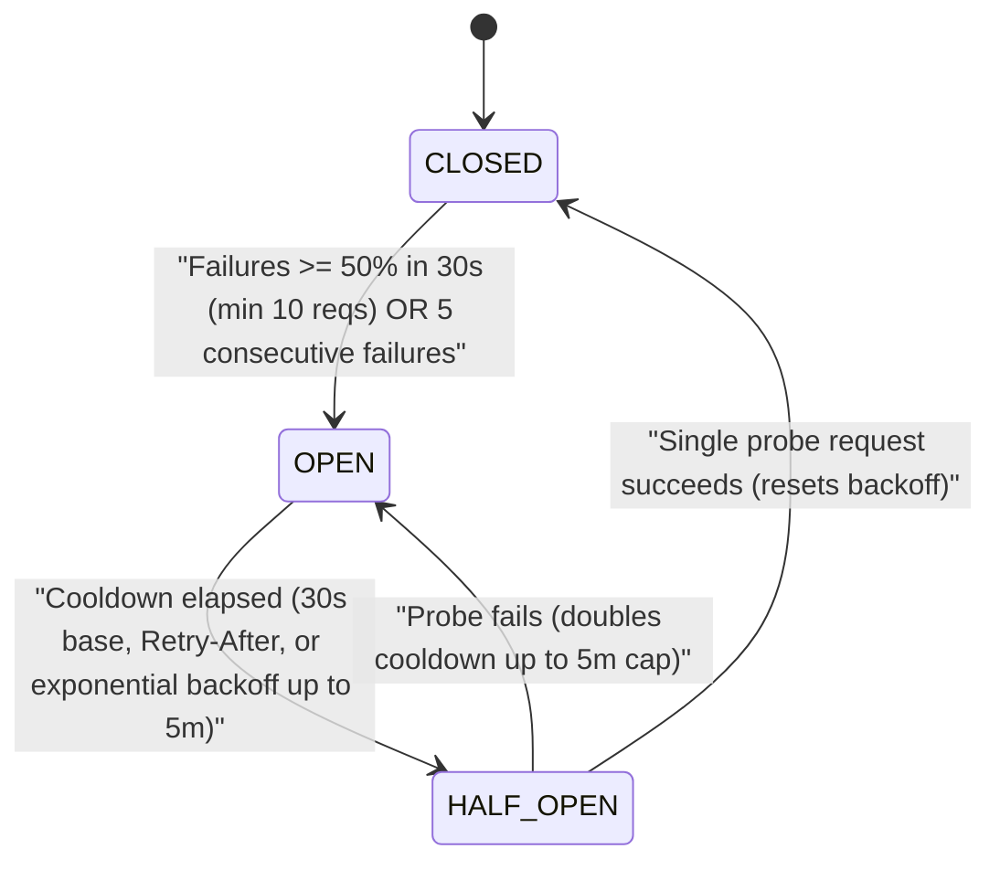

# 05 — Resilience, Circuit Breakers & Rate Limiting

## In Plain Words

LLM providers fail frequently — they throttle requests (`429`), return `5xx` errors, or hang mid-stream. CacheRoute protects your application with strict timeouts, automatic failover across backup providers, shared Redis circuit breakers that stop calling broken providers, and atomic Redis token-bucket rate limits.

---

## 1. Network & Upstream Timeouts

Configured on `OpenAICompatibleProvider` using `undici` and `AbortSignal`:

| Timeout Layer | Limit | Behavior on Expiry |
| :--- | :---: | :--- |
| **TCP / TLS Connect** | `3s` (`3,000 ms`) | Abort attempt, record breaker failure, fail over |
| **Upstream First Byte (TTFT)** | `20s` (`20,000 ms`) | Abort attempt, record breaker failure, fail over (if before client first byte) |
| **Idle Between Stream Chunks** | `30s` (`30,000 ms`) | Abort stream, emit SSE error event + `[DONE]`, close cleanly |
| **Total Request Budget** | `120s` (`120,000 ms`) | Safely under Vercel Hobby's `300s` max function duration |
| **Max Provider Attempts** | `3` attempts | Across distinct providers along the route; **no same-provider retry** |

---

## 2. Error Handling & Failover Matrix

| Upstream Result | Failover? | Counts as Breaker Failure? | Client Behavior & Logging |
| :--- | :---: | :---: | :--- |
| **`400`, `404`, `422`** | **No** | **No** | Return `4xx` OpenAI error directly to client (client's own bad payload shouldn't trip provider breaker) |
| **`401`, `403`** | **Yes** | **Yes** | Fail over to backup provider; log **`CRITICAL`** alert (upstream API key expired/misconfigured) |
| **`408`, `429`, `5xx`, Connect/TTFT Timeout, `ECONNRESET`** | **Yes** | **Yes** | Fail over to next provider; if `429` includes `Retry-After`, open breaker for that duration |
| **All providers failed / all breakers `OPEN`** | **No** | Already recorded | Return `503` OpenAI error (`code: "all_providers_failed"`) |

---

## 3. Distributed Circuit Breaker State Machine

Circuit breaker state lives in **Redis** (`cr:cb:{provider}`) so multiple Vercel Fluid Compute instances share provider health instantly. Transitions run inside an **atomic Lua script** (`circuit_breaker.lua`).



### 3.1 Exact Breaker Thresholds & Rules
- **CLOSED → OPEN:** Triggers when **either**:
  1. Over a `30s` sliding window with at least `10` completed requests, the failure rate is **`>= 50%`**, **OR**
  2. **`5` consecutive failures** occur (protects low-traffic routes immediately).
- **OPEN Duration & Backoff:**
  - Base cooldown: **`30s`** (or the provider's `Retry-After` header value if higher).
  - If a half-open probe fails, the breaker re-opens and **doubles** the cooldown (`30s → 60s → 120s → 240s → 300s`), capped at **`5 minutes` (`300s`)**.
- **HALF_OPEN Probe Lock:**
  - When cooldown expires, a request attempts `SET cr:cb:{provider}:probe 1 NX EX 10`.
  - Only the **single winning request** runs the probe; concurrent requests continue failing fast / routing to fallback providers until the probe finishes (or the `10s` lock expires).

### 3.2 Circuit Breaker Lua Logic (Pseudocode)

```lua
-- KEYS[1]: cr:cb:{provider}
-- KEYS[2]: cr:cb:{provider}:probe
-- ARGV[1]: action ("can_execute" | "record_success" | "record_failure")
-- ARGV[2]: now_ms
-- ARGV[3]: retry_after_ms (0 if none)

-- On "can_execute":
--   if state == "CLOSED" -> return {1, "CLOSED"}
--   if state == "OPEN":
--     if now_ms < open_until_ms -> return {0, "OPEN"}
--     if redis.call("SET", KEYS[2], "1", "NX", "EX", 10) then
--       redis.call("HSET", KEYS[1], "state", "HALF_OPEN")
--       return {1, "HALF_OPEN"}
--     end
--     return {0, "OPEN"} -- another instance holds the probe lock
--   if state == "HALF_OPEN" -> return {0, "HALF_OPEN"} -- probe already in flight

-- On "record_success":
--   if state == "HALF_OPEN" or consecutive_failures > 0:
--     reset state="CLOSED", consecutive_failures=0, backoff_level=0, release probe lock
--   record success event in 30s window

-- On "record_failure":
--   increment consecutive_failures; record failure in 30s window
--   if state == "HALF_OPEN" or consecutive_failures >= 5 or (window_total >= 10 and fail_rate >= 0.5):
--     backoff_ms = min(300000, max(30000 * (2 ^ backoff_level), retry_after_ms))
--     set state="OPEN", open_until_ms = now_ms + backoff_ms, increment backoff_level, release probe lock
```

---

## 4. Token-Bucket Rate Limiter & Daily Token Budget

### 4.1 Token Bucket (`token_bucket.lua`)
- Loaded via `SCRIPT LOAD` and invoked with `EVALSHA` (with automatic `NOSCRIPT` fallback to `EVAL`).
- **Defaults:** `60` RPM (`refillRate = 1` token/sec), `burst = 20` tokens.
- **Public Demo Key Limit:** `10` RPM, `20,000` tokens/day, restricted to `cr-fast`.

```lua
-- KEYS[1]: cr:rl:{keyId}
-- ARGV[1]: capacity (burst, e.g. 20)
-- ARGV[2]: refill_per_sec (rpm / 60, e.g. 1.0)
-- ARGV[3]: cost (1)
-- ARGV[4]: now_sec

local b = redis.call("HMGET", KEYS[1], "tokens", "last_ts")
local tokens = tonumber(b[1])
local last_ts = tonumber(b[2])

if tokens == nil then
  tokens = tonumber(ARGV[1])
  last_ts = tonumber(ARGV[4])
else
  local elapsed = math.max(0, tonumber(ARGV[4]) - last_ts)
  tokens = math.min(tonumber(ARGV[1]), tokens + elapsed * tonumber(ARGV[2]))
  last_ts = tonumber(ARGV[4])
end

local allowed = 0
if tokens >= tonumber(ARGV[3]) then
  tokens = tokens - tonumber(ARGV[3])
  allowed = 1
end

redis.call("HMSET", KEYS[1], "tokens", tokens, "last_ts", last_ts)
local ttl = math.max(60, math.ceil(tonumber(ARGV[1]) / tonumber(ARGV[2])) * 2)
redis.call("EXPIRE", KEYS[1], ttl)

return { allowed, tokens }
```

### 4.2 Daily Token Budget (`RedisTokenBudget`)
- **Key:** `cr:budget:{keyId}:{yyyymmdd}` (UTC date).
- **Pre-Check:** Reject with `429 token_budget_exceeded` if `current >= api_keys.daily_token_budget` (`200,000` default).
- **Post-Response Accounting:** `BackgroundTasks` calls `INCRBY key (prompt_tokens + completion_tokens)` and sets `EXPIRE key 172800` (`48h` TTL) so yesterday's usage keys expire automatically.

---

## 5. Degraded Mode Matrix (Infrastructure Outages)

| Outage | Rate Limiter | L1 Exact Cache | Circuit Breaker | Auth & L2 & Logs |
| :--- | :--- | :--- | :--- | :--- |
| **Redis Unreachable** | **Fail-open** (allow traffic; log & increment error metric) | **Skipped** (proceeds to L2 / upstream) | Falls back to `InMemoryCircuitBreaker` per instance | Auth uses Postgres; L2 & logs work normally |
| **Postgres Unreachable** | Works via Redis | Works via Redis | Works via Redis | **Auth fails closed (`503`)** if key isn't in `cr:key:{sha256}` Redis cache; **L2 skipped**; **logs dropped** (counted) |
