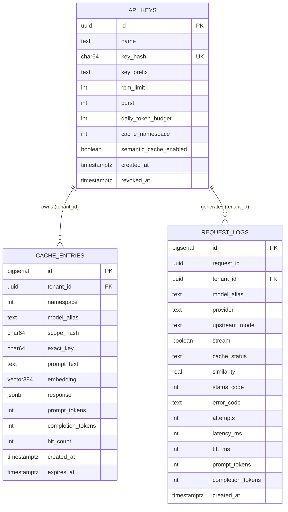

# 06 — Data Model

## In Plain Words

PostgreSQL (with the `pgvector` extension) stores three tables: API keys (`api_keys`), semantic cache vectors (`cache_entries`), and request analytics (`request_logs`). Redis stores fast, short-lived operational state: exact cache answers, rate-limit buckets, daily token counters, circuit-breaker state, and a 60-second auth cache.

---

## 1. Entity Relationship Diagram



---

## 2. PostgreSQL Tables & Indexes

### 2.1 `api_keys`
Stores virtual client credentials. Plaintext `cr_live_*` keys are **never** stored — only their SHA-256 hash.

| Column | Type | Constraints / Default | Notes |
| :--- | :--- | :--- | :--- |
| `id` | `uuid` | `PRIMARY KEY DEFAULT gen_random_uuid()` | Tenant identifier |
| `name` | `text` | `NOT NULL` | Human label (e.g., `"public-demo"`) |
| `key_hash` | `char(64)` | `NOT NULL UNIQUE` | Hex SHA-256 of `cr_live_<32 random>` |
| `key_prefix` | `text` | `NOT NULL` | First ~12 chars for safe admin display |
| `rpm_limit` | `integer` | `NOT NULL DEFAULT 60` | Token-bucket refill rate (`rpm / 60` per sec) |
| `burst` | `integer` | `NOT NULL DEFAULT 20` | Token-bucket capacity |
| `daily_token_budget` | `integer` | `NOT NULL DEFAULT 200000` | Daily combined input + output token cap |
| `cache_namespace` | `integer` | `NOT NULL DEFAULT 1` | Incremented on `DELETE /admin/cache` |
| `semantic_cache_enabled` | `boolean` | `NOT NULL DEFAULT true` | Per-key L2 semantic cache toggle |
| `created_at` | `timestamptz` | `NOT NULL DEFAULT now()` | Creation time |
| `revoked_at` | `timestamptz` | `NULL` | Non-null revokes key immediately |

### 2.2 `cache_entries`
Stores normalized prompt embeddings and cached completions for L2 semantic lookup.

| Column | Type | Constraints / Default | Notes |
| :--- | :--- | :--- | :--- |
| `id` | `bigserial` | `PRIMARY KEY` | Surrogate row ID |
| `tenant_id` | `uuid` | `NOT NULL REFERENCES api_keys(id) ON DELETE CASCADE` | Tenant isolation |
| `namespace` | `integer` | `NOT NULL` | Must match `api_keys.cache_namespace` |
| `model_alias` | `text` | `NOT NULL` | e.g., `cr-fast`, `cr-smart`, `mock` |
| `scope_hash` | `char(64)` | `NOT NULL` | SHA-256 of system + prior messages + params |
| `exact_key` | `char(64)` | `NOT NULL` | Canonical SHA-256 used in L1 |
| `prompt_text` | `text` | `NOT NULL` | Last user message text (for debugging/audit) |
| `embedding` | `vector(384)` | `NOT NULL` | `Xenova/all-MiniLM-L6-v2` q8 normalized vector |
| `response` | `jsonb` | `NOT NULL` | Cached OpenAI completion payload |
| `prompt_tokens` | `integer` | `NOT NULL DEFAULT 0` | Recorded input tokens |
| `completion_tokens` | `integer` | `NOT NULL DEFAULT 0` | Recorded output tokens |
| `hit_count` | `integer` | `NOT NULL DEFAULT 0` | Incremented on L2 cache hit |
| `created_at` | `timestamptz` | `NOT NULL DEFAULT now()` | Write timestamp |
| `expires_at` | `timestamptz` | `NOT NULL` | Default `created_at + 24 hours` |

### 2.3 `request_logs`
Powers production observability (`GET /admin/stats`) where per-instance Prometheus scraping is unavailable.

| Column | Type | Constraints / Default | Notes |
| :--- | :--- | :--- | :--- |
| `id` | `bigserial` | `PRIMARY KEY` | Surrogate row ID |
| `request_id` | `uuid` | `NOT NULL` | Correlates with `x-request-id` & Pino logs |
| `tenant_id` | `uuid` | `REFERENCES api_keys(id) ON DELETE SET NULL` | Nullable if auth failed |
| `model_alias` | `text` | `NOT NULL` | Requested alias |
| `provider` | `text` | `NOT NULL` | `cache`, `groq`, `gemini`, `openrouter`, `mock-*` |
| `upstream_model` | `text` | `NULL` | Actual provider model ID served |
| `stream` | `boolean` | `NOT NULL DEFAULT false` | Whether client requested SSE streaming |
| `cache_status` | `text` | `NOT NULL` | `HIT-EXACT`, `HIT-SEMANTIC`, `MISS`, `BYPASS` |
| `similarity` | `real` | `NULL` | Cosine similarity on `HIT-SEMANTIC` |
| `status_code` | `integer` | `NOT NULL` | Final HTTP status returned |
| `error_code` | `text` | `NULL` | OpenAI error code if `>= 400` |
| `attempts` | `integer` | `NOT NULL DEFAULT 0` | Number of upstream provider attempts |
| `latency_ms` | `integer` | `NOT NULL` | Total gateway duration in ms |
| `ttft_ms` | `integer` | `NULL` | Time to First Token for streaming requests |
| `prompt_tokens` | `integer` | `NOT NULL DEFAULT 0` | Reported input tokens |
| `completion_tokens` | `integer` | `NOT NULL DEFAULT 0` | Reported output tokens |
| `created_at` | `timestamptz` | `NOT NULL DEFAULT now()` | Log timestamp |

### 2.4 Index DDL & Retention

```sql
CREATE EXTENSION IF NOT EXISTS vector;

-- cache_entries indexes
CREATE UNIQUE INDEX idx_cache_entries_unique_exact
  ON cache_entries (tenant_id, namespace, exact_key);

CREATE INDEX idx_cache_entries_scope_lookup
  ON cache_entries (tenant_id, namespace, model_alias, scope_hash, expires_at);

CREATE INDEX idx_cache_entries_hnsw_embedding
  ON cache_entries USING hnsw (embedding vector_cosine_ops)
  WITH (m = 16, ef_construction = 64);

-- request_logs indexes
CREATE INDEX idx_request_logs_created_at
  ON request_logs (created_at);

CREATE INDEX idx_request_logs_tenant_created_at
  ON request_logs (tenant_id, created_at);
```

- **Retention Policy:**
  - `request_logs`: `30 days` (pruned periodically via cleanup query `WHERE created_at < NOW() - INTERVAL '30 days'`).
  - `cache_entries`: `24 hours` default (`expires_at`); expired or superseded namespace rows are filtered at read time and pruned alongside log maintenance.

---

## 3. Redis Key Schema

| Key Pattern | Data Structure | Contents | TTL |
| :--- | :--- | :--- | :--- |
| `cr:rl:{keyId}` | Hash | `tokens`, `last_ts` (token-bucket state) | Auto (`max(60s, 2 * burst / refill)`) |
| `cr:budget:{keyId}:{yyyymmdd}` | String (Int) | Cumulative daily tokens (`prompt + completion`) | `48h` (`172800s`) |
| `cr:cb:{provider}` | Hash | `state`, `open_until_ms`, `consecutive_failures`, `backoff_level`, `win_json` | Persistent |
| `cr:cb:{provider}:probe` | String | `"1"` (`SET NX` distributed probe lock) | `10s` |
| `cr:cache:{tenant}:{ns}:{sha256}` | String (JSON) | Serialized completion response + token counts | `24h` (`86400s`) |
| `cr:key:{sha256}` | String (JSON) | Cached `ApiKey` record from Postgres | `60s` |
